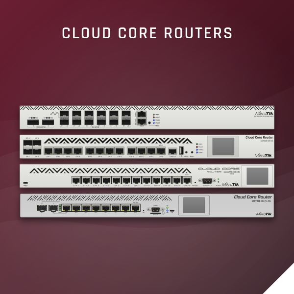
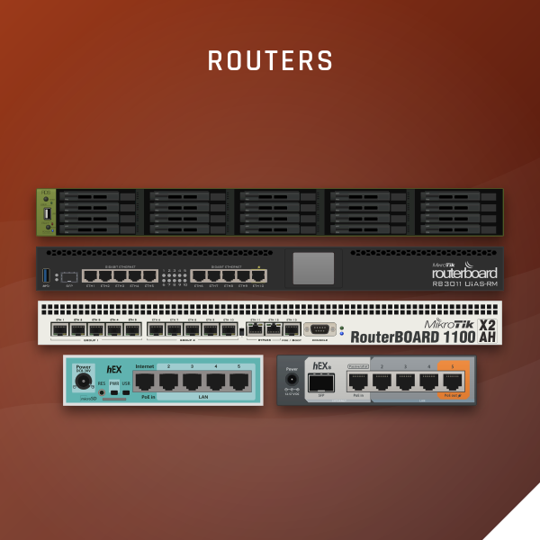
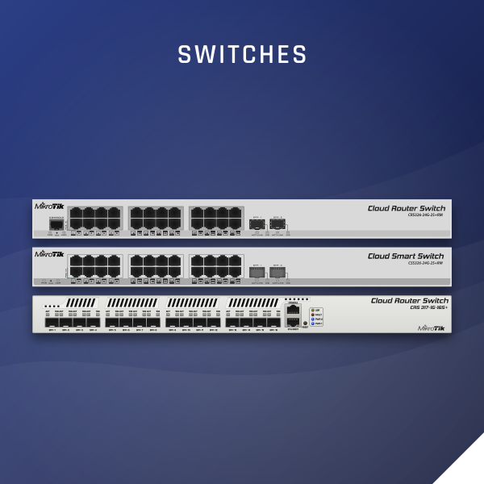
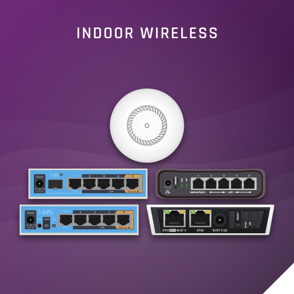
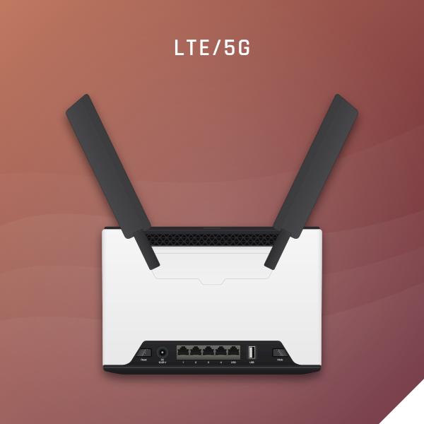
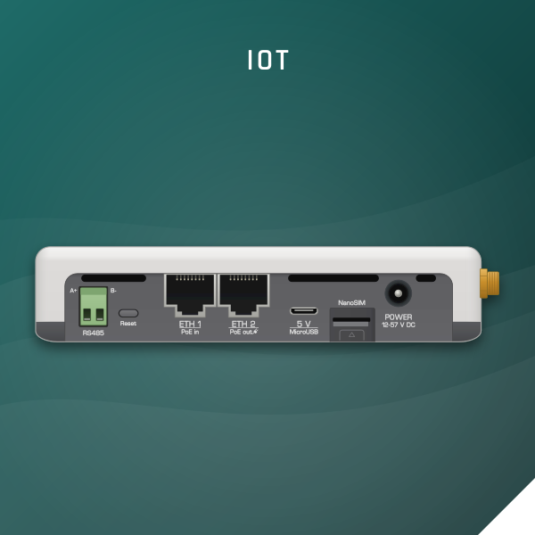
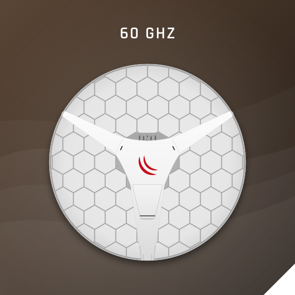
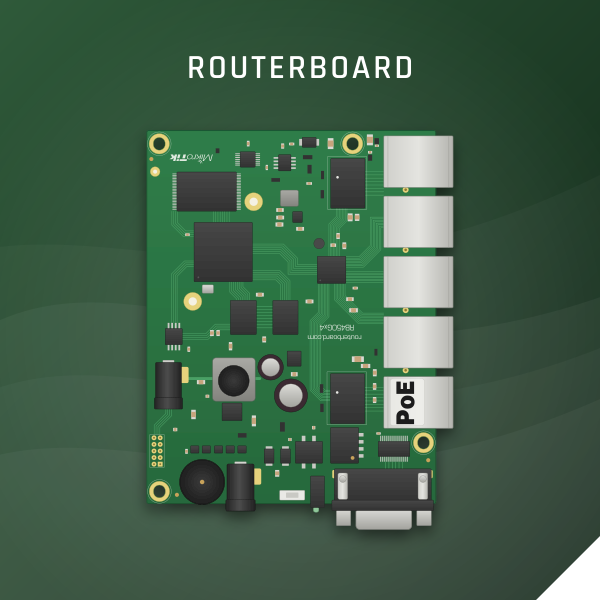

<h1 align="center">drawio-mikrotik</h1>

<p align="center">
<b>Vector MikroTik device library for <a href="https://www.drawio.com">draw.io</a> (diagrams.net)</b><br>
Front panels drawn by hand as clean SVG, no raster images.
</p>

<!-- badges:start -->
<p align="center">

<a href="LICENSE"></a>
<a href="#support-the-project"></a>
</p>
<!-- badges:end -->

<!-- note:start -->
> [!NOTE]
> This is the `dev` branch: a preview of the next release. Links on this page point to the files of this branch.
<!-- note:end -->

<!-- tiles:start -->
<p align="center">
<a href="https://github.com/HugoFiermein/drawio-mikrotik/blob/dev/library/MikroTik-cloud-core-routers.xml"></a>
<a href="https://github.com/HugoFiermein/drawio-mikrotik/blob/dev/library/MikroTik-routers.xml"></a>
<a href="https://github.com/HugoFiermein/drawio-mikrotik/blob/dev/library/MikroTik-switches.xml"></a>
</p>
<p align="center">
<a href="https://github.com/HugoFiermein/drawio-mikrotik/blob/dev/library/MikroTik-indoor-wireless.xml"></a>
<a href="https://github.com/HugoFiermein/drawio-mikrotik/blob/dev/library/MikroTik-lte-5g.xml"></a>
<a href="https://github.com/HugoFiermein/drawio-mikrotik/blob/dev/library/MikroTik-iot.xml"></a>
</p>
<p align="center">
<a href="https://github.com/HugoFiermein/drawio-mikrotik/blob/dev/library/MikroTik-60ghz.xml"></a>
<a href="https://github.com/HugoFiermein/drawio-mikrotik/blob/dev/library/MikroTik-routerboard.xml"></a>
</p>
<!-- tiles:end -->

<p align="center"><sub>Click a category to download its draw.io library.</sub></p>

## Why this library

- **Real vector.** Every device is drawn as shapes, not a photo wrapped in SVG: sharp at any zoom and only tens of kilobytes per model.
- **Drawn from the hardware.** Ports, LEDs, buttons and labels sit where they are on the actual panel.
- **Split by category.** Load only the palettes you need.

## Install

### draw.io in the browser

**[Open draw.io with the MikroTik libraries](https://app.diagrams.net/?clibs=Uhttps%3A%2F%2Fraw.githubusercontent.com%2FHugoFiermein%2Fdrawio-mikrotik%2Fdev%2Flibrary%2FMikroTik-60ghz.xml;Uhttps%3A%2F%2Fraw.githubusercontent.com%2FHugoFiermein%2Fdrawio-mikrotik%2Fdev%2Flibrary%2FMikroTik-cloud-core-routers.xml;Uhttps%3A%2F%2Fraw.githubusercontent.com%2FHugoFiermein%2Fdrawio-mikrotik%2Fdev%2Flibrary%2FMikroTik-indoor-wireless.xml;Uhttps%3A%2F%2Fraw.githubusercontent.com%2FHugoFiermein%2Fdrawio-mikrotik%2Fdev%2Flibrary%2FMikroTik-iot.xml;Uhttps%3A%2F%2Fraw.githubusercontent.com%2FHugoFiermein%2Fdrawio-mikrotik%2Fdev%2Flibrary%2FMikroTik-lte-5g.xml;Uhttps%3A%2F%2Fraw.githubusercontent.com%2FHugoFiermein%2Fdrawio-mikrotik%2Fdev%2Flibrary%2FMikroTik-routerboard.xml;Uhttps%3A%2F%2Fraw.githubusercontent.com%2FHugoFiermein%2Fdrawio-mikrotik%2Fdev%2Flibrary%2FMikroTik-routers.xml;Uhttps%3A%2F%2Fraw.githubusercontent.com%2FHugoFiermein%2Fdrawio-mikrotik%2Fdev%2Flibrary%2FMikroTik-switches.xml)**: one click, all categories. draw.io keeps them in the sidebar on the next visit (until browser data is cleared).

### draw.io desktop

Click a category at the top of this page to download its library file, then:

1. Put the downloaded files in a folder you will keep, for example `Documents\draw.io\MikroTik`. draw.io opens them from that path every time, so do not leave them in *Downloads* if you clean it.
2. In draw.io choose *File → Open Library…* and select the files (several at once is fine). Each file becomes its own palette in the left sidebar.
3. That's it: draw.io remembers the palettes and shows them after a restart.

To update, download the files again, replace the old ones in the same folder and restart draw.io. To remove a palette, click the **×** in its header.

Shapes are images with `editableCssRules`; colours can be tweaked via *Edit Style*.

## Devices

<!-- devices:start -->
**47 models** in 8 categories, 132 more planned. Click a category to open its list.

<details>
<summary><b>Cloud Core Routers</b> &nbsp;·&nbsp; 11</summary>

| Model | Added |
|---|---|
| CCR1009-7G-1C-1S+ | v1.5 |
| CCR1009-7G-1C-1S+PC | v1.5 |
| CCR1009-7G-1C-PC | v1.5 |
| CCR1009-8G-1S | v1.4.1 or earlier |
| CCR1009-8G-1S-1S+ | v1.4.1 or earlier |
| CCR1009-8G-1S-1S+PC | v1.5 |
| CCR1009-8G-1S-PC | v1.4.1 or earlier |
| CCR1016-12G (plus old revision) | v1.5 |
| CCR1016-12S-1S+ | v1.5 |
| CCR1036-12G-4S (plus old revision) | v1.5 |
| CCR2216-1G-12XS-2XQ | v1.5 |

Planned (9): CCR1036-8G-2S+, CCR1036-12G-4S-EM, CCR1036-8G-2S+EM, CCR1072-1G-8S+, CCR2004-16G-2S+, CCR2004-16G-2S+PC, CCR2004-1G-12S+2XS, CCR2004-1G-2XS-PCIe, CCR2116-12G-4S+

</details>

<details>
<summary><b>Routers</b> &nbsp;·&nbsp; 17</summary>

| Model | Added |
|---|---|
| hEX S 2025 (E60iUGS) | v1.5 |
| RB1100 | v1.5 |
| RB1100AH | v1.5 |
| RB1100AHx2 | v1.5 |
| RB1100AHx2-LM | v1.5 |
| RB1100Hx2 | v1.5 |
| RB1200 | v1.5 |
| RB2011iL-IN | v1.5 |
| RB2011iL-RM | v1.5 |
| RB2011iLS-IN | v1.5 |
| RB2011UiAS-IN | v1.5 |
| RB2011UiAS-RM | v1.5 |
| RB3011UiAS-RM | v1.5 |
| RB5009UG+S+IN | v1.5 |
| hEX (RB750Gr3) | v1.5 |
| hEX S (RB760iGS) | v1.5 |
| ROSE Data server (RDS2216-2XG-4S+4XS-2XQ, front and rear) | v1.5 |

Planned (13): RB1000, RB1000U, RB1100AHx4, RB1100AHx4 Dude Edition, RB4011iGS+RM, RB5009UPr+S+IN, RB5009UPr+S+OUT, L009UiGS-RM, hEX lite, hEX PoE lite, hEX PoE, hEX refresh, PowerBox Pro

</details>

<details>
<summary><b>Indoor Wireless</b> &nbsp;·&nbsp; 9</summary>

| Model | Added |
|---|---|
| hAP ax3 (C53UiG+5HPaxD2HPaxD) | v1.5 |
| RB2011UiAS-2HnD-IN | v1.4.1 or earlier |
| hAP lite (RB941-2nD, plus old revision) | v1.5 |
| RB951Ui-2HnD | v1.4.1 or earlier |
| hAP ac lite (RB952Ui-5ac2nD) | v1.5 |
| hAP ac (RB962UiGS-5HacT2HnT) | v1.5 |
| cAP ac (RBcAPGi-5acD2nD) | v1.5 |
| hAP ac2 (RBD52G-5HacD2HnD-TC) | v1.5 |
| wAP ac (RBwAPG-5HacD2HnD) | v1.5 |

Planned (18): hAP, hAP lite TC, hAP ac lite TC, hAP ac3, hAP ax lite, hAP ax S, hAP ax2, hAP be lite, hAP be3 Media, cAP, cAP lite, cAP XL ac, cAP ax, mAP, mAP lite, wAP ax, L009UiGS-2HaxD-IN, RB4011iGS+5HacQ2HnD-IN

</details>

<details>
<summary><b>Switches</b> &nbsp;·&nbsp; 5</summary>

| Model | Added |
|---|---|
| CRS317-1G-16S+RM | v1.5 |
| CRS326-24G-2S+RM | v1.5 |
| CRS812 DDQ (CRS812-8DS-2DQ-2DDQ-RM) | v1.5 |
| CSS326-24G-2S+RM | v1.4.1 or earlier |
| FiberBox (CRS105-5S-FB, front and inner panel) | v1.5 |

Planned (46): RB250GS, RB260GS, RB260GSP, CRS106-1C-5S, CRS109-8G-1S-2HnD-IN, CRS112-8G-4S-IN, CRS112-8P-4S-IN, CRS125-24G-1S-IN, CRS125-24G-1S-RM, CRS125-24G-1S-2HnD-IN, CRS210-8G-2S+IN, CRS212-1G-10S-1S+IN, CRS226-24G-2S+IN, CRS226-24G-2S+RM, CRS304-4XG-IN, CRS305-1G-4S+IN, CRS309-1G-8S+IN, CRS310-1G-5S-4S+IN, CRS310-8G+2S+IN, CRS312-4C+8XG-RM, CRS320-8P-8B-4S+RM, CRS326-24G-2S+IN, CRS326-24S+2Q+RM, CRS326-4C+20G+2Q+RM, CRS328-24P-4S+RM, CRS328-4C-20S-4S+RM, CRS354-48G-4S+2Q+RM, CRS354-48P-4S+2Q+RM, CRS418-8P-8G-2S+RM, CRS418-8P-8G-2S+5axQ2axQ-RM, CRS504-4XQ-IN, CRS504-4XQ-OUT, CRS510-8XS-2XQ-IN, CRS518-16XS-2XQ-RM, CRS520-4XS-16XQ-RM, CRS804 DDQ, CSS318-16G-2S+IN, CSS610-8G-2S+IN, CSS610-8P-2S+IN, FiberBox Plus, netFiber 9, netPower 15FR, netPower 16P, netPower Lite 7R, netPower Lite 8P, GPERx6

</details>

<details>
<summary><b>LTE/5G</b> &nbsp;·&nbsp; 2</summary>

| Model | Added |
|---|---|
| Chateau LTE12 2025 (D53G-5HacD2HnD-TC&EG120K-EA) | v1.5 |
| Chateau 5G R17 ax (S53UG+5HaxD2HaxD-TC&RG650E-EU) | v1.5 |

Planned (20): Chateau LTE6-US, Chateau LTE7, Chateau LTE7 ax, Chateau LTE18 ax, Chateau PRO ax, cAP LTE12 ax, wAP R, wAP LTE kit, wAP ax LTE7 kit, LtAP mini, LtAP mini LTE kit, LtAP LTE7 kit, SXT LTE7 kit, SXTsq Embedded LTE4, SXTsq Embedded LTE4 Global, LHG LTE18 kit, LHGG LTE7 kit, ATL LTE18 kit, ATL 5G R16, LAMP 5G R16

</details>

<details>
<summary><b>IoT</b> &nbsp;·&nbsp; 1</summary>

| Model | Added |
|---|---|
| KNOT LR9G (RB924iR-2nD-BT5&BG770A&R11e-LR9G) | v1.5 |

Planned (16): KNOT, KNOT Embedded LTE4, KNOT Embedded LTE4 Global, KNOT Gateway LR8, KNOT Gateway HL9, KNOT LR8G kit, CME Gateway, wAP LR2 kit, wAP LR8G kit, wAP LR9G kit, CLAIRÉ, CLAIRÉ Lite, TG-BT5-IN, TG-BT5-OUT, TG-LR82, TG-LR92

</details>

<details>
<summary><b>60 GHz</b> &nbsp;·&nbsp; 1</summary>

| Model | Added |
|---|---|
| LHG 60G (RBLHGG-60ad) | v1.5 |

Planned (3): Cube 60Pro ac, CubeSA 60Pro ac, Wireless Wire Cube Pro

</details>

<details>
<summary><b>RouterBOARD</b> &nbsp;·&nbsp; 1</summary>

| Model | Added |
|---|---|
| RB450Gx4 | v1.5 |

Planned (7): RBM33G, RB911G-5HPnD, RB912UAG-2HPnD, RB912UAG-5HPnD, RB922UAGS-5HPacD, L11UG-5HaxD, L23UGSR-5HaxD2HaxD

</details>

<!-- devices:end -->

Missing a model you need? [Open an issue](https://github.com/HugoFiermein/drawio-mikrotik/issues).

## Smoother draw.io with large libraries

draw.io redraws every detailed SVG on each scroll and zoom frame, which gets slow with many device shapes on screen. [drawio-svg-cache](https://github.com/HugoFiermein/drawio-svg-cache) is an optional script that fixes this for the browser and the desktop app. The library works without it.

## Support the project

The library is free and stays free. If it saves you time, you can support new models with crypto:

| Coin and network | Address |
|---|---|
| USDT on TRON (TRC20) | `TUkAd4at57htHHrRmaAysJ9uPxgEUrtuT6` |
| Bitcoin | `bc1qgglpgr8ygww6vyp2wnzcxet7xmtg30xch0p5va` |
| ETH or USDT on Ethereum (ERC20) / BNB Smart Chain (BEP20) | `0x1a980eAD0584E6e8084D4B21f7d329e9C1875D46` |

Send each coin only through the network named next to its address: coins sent through another network are lost.

## Versions

`MAJOR.MINOR.PATCH`:

- **PATCH** (1.5.1): fixes and touch-ups of existing models: colours, labels, details.
- **MINOR** (1.6 … 1.9, 1.10, 1.11 …): new models or a new category.
- **MAJOR** (2.0): reserved for a complete rework of the library. Not planned.

Releases v1.0–v1.4.1 keep their original tags. Full history: [CHANGELOG.md](CHANGELOG.md).

## Repository layout

```
svg/<category>/   source SVGs, one file per model
library/          built draw.io libraries, one file per category
docs/tiles/       category tiles for this README
```

## License

Drawings and libraries: © HugoFiermein, [CC BY-SA 4.0](LICENSE).

- **Using the shapes in your diagrams, documentation and presentations** (commercial work included) is free: no credit is needed on the diagram, and you may recolour or resize the shapes there.
- **Redistributing the library or the shapes**, changed or not: credit the author with a link to this repository, say what you changed, and keep the same licence.

MikroTik, RouterBOARD and the MikroTik logo are trademarks of SIA Mikrotīkls. This project is not affiliated with or endorsed by MikroTik. The licence above covers the drawings only, not the trademarks shown on the devices.
